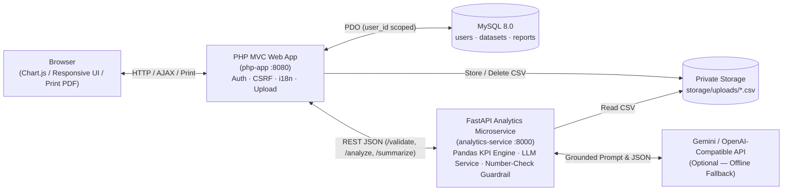

# AI Business Reporting Assistant

**AI Business Reporting Assistant** transforms raw sales CSV files into verified KPI dashboards, interactive Chart.js visualizations, and hallucination-checked bilingual executive reports. Built with a local-first PHP MVC web app and a Python/FastAPI analytics microservice, it pairs deterministic Pandas calculations with an LLM grounding guardrail and an automatic offline fallback.


---

## Key Features

- **CSV Ingestion & Row-Level Validation:** Drag-and-drop upload (up to 5 MB / 50,000 rows) stored outside `public/`, with duplicate-file detection (filename + SHA-256 hash) and strict validation across `date`, `order_id`, `product`, `category`, `quantity`, and `unit_price`.
- **KPI Analytics & Interactive Dashboards:** Pandas-powered KPI engine calculating total revenue, unique orders, Average Order Value (AOV), units sold, month-over-month growth, category share, and top products—rendered with interactive **Chart.js** bar/doughnut charts and date-range filters.
- **Grounded 3-Part AI Executive Reports:** Generates structured **Verified Facts**, **Interpretations**, and **Recommendations** powered by **Gemini** (`gemini-3.1-flash-lite` or any configured `LLM_MODEL` / OpenAI-compatible endpoint) with an automatic offline **`rule_based`** fallback.
- **Bilingual UI & Reports (EN / FR):** Instant English/French switching across the entire UI and saved reports (missing report translations are generated on demand from the saved metrics snapshot and cached in MySQL), plus duplicate-report protection across languages.
- **A4 Print / Save-as-PDF & Responsive Layout:** Dedicated `@media print` stylesheet (A4 page formatting, hidden navigation chrome, preserved chart/badge colors) and mobile-responsive grids (`@media (max-width: 768px)`).
- **Production Security Hardening:** HTTP security headers (`CSP`, `X-Frame-Options`, `X-Content-Type-Options`, `Referrer-Policy`), hardened session cookies, CSRF verification on all `POST` actions, login throttling, and `user_id`-scoped queries to prevent IDOR.

---

## System Architecture



---

## How the AI Grounding Guardrail Works

LLMs can invent or subtly round financial figures. To guarantee numerical integrity, every AI-generated summary passes through `verify_numbers_against_metrics()` in [`analytics-service/app/services/llm_service.py`](analytics-service/app/services/llm_service.py):

1. **Deterministic Calculation First:** Pandas computes all exact KPIs, monthly trends, category shares, top products, and period comparisons before any LLM call occurs.
2. **Strict Grounded Prompting:** `build_grounding_prompt()` passes the verified JSON metrics to the model and forbids inventing numbers or computing unverified derived ratios.
3. **Entity & Date Stripping:** Before scanning the AI output, `_collect_entity_labels()` strips known product and category names (e.g., `ProBook 14 Laptop`, `27-inch 4K Monitor`) and `DATE_PATTERN` strips ISO/calendar dates so model numbers or dates never trigger false positives.
4. **Numeric Pool Verification & Fallback:** Every remaining currency value, percentage, count, or quantity extracted from `headline`, `executive_summary`, `facts`, `interpretations`, and `recommendations` is checked against the verified KPI pool (`tolerance = 0.02`). If **any** unverified number is detected, the LLM response is rejected and the engine falls back cleanly to the deterministic `rule_based` generator. Verified reports display a green **Verified (`N` metrics checked)** badge.

---

## Security Highlights

- **HTTP Security Headers** (`php-app/public/index.php`): Enforces `Content-Security-Policy` (allowing `self` and `https://cdn.jsdelivr.net` for Chart.js), `X-Frame-Options: DENY`, `X-Content-Type-Options: nosniff`, and `Referrer-Policy: strict-origin-when-cross-origin`.
- **Hardened Session Cookies** (`php-app/app/Core/Session.php`): Enables `session.use_strict_mode = 1`, `HttpOnly`, `SameSite=Lax`, conditional `Secure` over HTTPS, and session ID regeneration on login (`session_regenerate_id(true)`).
- **CSRF Protection** (`php-app/app/Core/Csrf.php`): Every state-changing `POST` route (`/login`, `/register`, `/logout`, `/language`, `/datasets/upload`, `/datasets/confirm`, `/datasets/delete`, `/reports/generate`, `/reports/delete`) verifies a per-session CSRF token.
- **IDOR Prevention & Upload Safety:** All `Dataset` and `Report` queries scope strictly by authenticated `user_id`. Uploaded CSVs are validated for extension, MIME type (`finfo`), and size (5 MB max), renamed to random 32-char hex IDs, and stored outside `php-app/public/`.
- **Login Throttling** (`php-app/app/Controllers/AuthController.php`): Limits failed login attempts to 5 per 5-minute window.

---

## Tech Stack

| Layer | Technologies |
| :--- | :--- |
| **Frontend** | Server-rendered PHP Views, Vanilla JS (`fetch` AJAX, Drag-and-Drop, Modal), Custom CSS (Responsive + A4 Print), Chart.js 4.4 |
| **Web Backend** | PHP 8.x (Custom MVC Router, PDO, CSRF, Session Hardening, EN/FR i18n, cURL Client) |
| **Analytics & AI Service** | Python 3.11+, FastAPI 0.165, Uvicorn 0.54, Pandas 3.1, NumPy 2.5, HTTPX 0.28, Gemini / OpenAI-Compatible LLM API |
| **Database** | MySQL 8.0 (`InnoDB`, `utf8mb4_unicode_ci`, JSON metrics snapshots, cascading foreign keys) |
| **Testing & QA** | Pytest 9.2 (`FastAPI TestClient`, KPI engine & LLM grounding suites), PHP CLI syntax linter (`php -l`) |

---

## Quick Start & Local Setup

### 1. Prerequisites

- **PHP 8.2+** with extensions enabled in `php.ini`: `pdo_mysql`, `curl`, `mbstring`, `fileinfo`, `openssl`, `json`, `session`
- **Python 3.11+** and `pip`
- **MySQL 8.0+** running locally

### 2. Database Setup

Create a MySQL database (e.g., `ai_reporting`) and import the schema from [`database/schema/001_initial_schema.sql`](database/schema/001_initial_schema.sql):

```powershell
mysql -u root -p -e "CREATE DATABASE IF NOT EXISTS ai_reporting CHARACTER SET utf8mb4 COLLATE utf8mb4_unicode_ci;"
Get-Content database\schema\001_initial_schema.sql | mysql -u root -p ai_reporting
```

### 3. Environment Configuration

Copy `.env.example` to `.env` and fill in your local credentials:

```powershell
Copy-Item .env.example .env
```

| Variable | Required | Default / Example | Description |
| :--- | :---: | :--- | :--- |
| `APP_ENV` | No | `development` | Application environment (`development` or `production`) |
| `APP_DEBUG` | No | `true` | Enables PHP error display when `true` |
| `DB_HOST` / `DB_PORT` | Yes | `127.0.0.1` / `3306` | MySQL host and port |
| `DB_NAME` / `DB_USER` / `DB_PASS` | Yes | *(your credentials)* | MySQL database name, username, and password |
| `ANALYTICS_API_URL` | Yes | `http://127.0.0.1:8000` | Base URL for the FastAPI analytics microservice |
| `STORAGE_UPLOADS_PATH` | No | `storage/uploads` | Private directory for uploaded CSV files (outside `public/`) |
| `LLM_PROVIDER` | No | `none` | `none`, `gemini`, or `openai_compatible` |
| `LLM_API_KEY` | No | *(blank)* | API key for Gemini/OpenAI. **Leave blank to run offline in `rule_based` mode** |
| `LLM_MODEL` | No | `gemini-3.1-flash-lite` | Model identifier (e.g., `gemini-3.1-flash-lite`) |
| `LLM_BASE_URL` | No | *(blank)* | Custom base URL when using `LLM_PROVIDER=openai_compatible` |

### 4. Python Virtual Environment & Dependencies

```powershell
cd analytics-service
python -m venv .venv
.\.venv\Scripts\pip.exe install -r requirements.txt
cd ..
```

### 5. Running the App

**Option A — One-Click Windows Launcher (Recommended):**

```powershell
.\start.ps1
```

This starts FastAPI on `http://127.0.0.1:8000`, starts the PHP web app on `http://127.0.0.1:8080`, and opens your browser automatically.

**Option B — Manual Two-Terminal Setup:**

```powershell
# Terminal 1: FastAPI analytics microservice
cd analytics-service
.\.venv\Scripts\python.exe -m uvicorn app.main:app --host 127.0.0.1 --port 8000
```

```powershell
# Terminal 2: PHP web application (from project root)
php -S 127.0.0.1:8080 -t php-app/public
```

### 6. 60-Second Demo Walkthrough

1. Open `http://127.0.0.1:8080`, register an account, and log in.
2. Upload [`samples/demo_sales.csv`](samples/demo_sales.csv) via the drag-and-drop uploader on the Dashboard.
3. Review the row-level validation summary and click **Confirm Dataset for Analytics**.
4. Open **Analytics** to explore KPI cards, Chart.js graphs, and date-range filters.
5. Click **Generate & Save Executive Report** to produce a verified 3-part AI report (Facts, Interpretations, Recommendations).
6. Toggle **EN / FR** in the navbar to switch both the UI and the report content between English and French, then click **Print / Save PDF** to preview the A4 report layout.

---

## Expected CSV Schema

Uploaded files must be valid UTF-8 `.csv` files (max 5 MB, up to 50,000 rows) containing these 6 required columns (case-insensitive headers):

| Column | Type / Format | Validation Rule | Sample Value (`samples/demo_sales.csv`) |
| :--- | :--- | :--- | :--- |
| `date` | `YYYY-MM-DD` | Valid calendar date | `2026-07-03` |
| `order_id` | String | Non-empty identifier | `ORD-1001` |
| `product` | String | Non-empty product name | `ProBook 14 Laptop` |
| `category` | String | Non-empty category name | `Electronics` |
| `quantity` | Number (`> 0`) | Positive numeric value | `1` |
| `unit_price` | Decimal (`>= 0`) | Non-negative numeric value | `1150.00` |

---

## Testing & Quality Checks

**Run the Python / FastAPI `pytest` suite:**

```powershell
cd analytics-service
.\.venv\Scripts\python.exe -m pytest -v
```

**Lint all PHP source files for syntax errors:**

```powershell
Get-ChildItem -Path php-app -Recurse -Filter *.php | ForEach-Object { php -l $_.FullName }
```

---

## Project Structure

```text
ai-business-reporting-assistant/
├── .env.example                          # Environment variable template
├── start.ps1                             # One-click Windows launcher (FastAPI + PHP)
├── README.md
├── analytics-service/                    # Python / FastAPI analytics & AI microservice
│   ├── requirements.txt
│   ├── app/
│   │   ├── main.py                       # FastAPI app & router registration
│   │   ├── routers/                      # /health, /validate, /analyze, /summarize
│   │   └── services/
│   │       ├── csv_validator.py          # Schema & row-level CSV validator
│   │       ├── kpi_engine.py             # Pandas KPI, trends & period comparison engine
│   │       ├── llm_service.py            # Gemini/OpenAI client & number-check guardrail
│   │       └── summary_engine.py         # Bilingual rule_based engine & LLM orchestration
│   └── tests/                            # Pytest suites (KPI, endpoints, LLM grounding)
├── database/
│   └── schema/
│       └── 001_initial_schema.sql        # MySQL tables (users, datasets, reports)
├── docs/
│   └── progress.md                       # Phase-by-phase build log
├── samples/
│   └── demo_sales.csv                    # Ready-to-use multi-month sample dataset
└── php-app/                              # PHP 8 MVC web application
    ├── config/config.php                 # .env loader & app configuration
    ├── lang/                             # English (en.php) & French (fr.php) dictionaries
    ├── public/
    │   ├── index.php                     # Front controller & HTTP security headers
    │   └── assets/css/app.css            # Responsive SaaS & A4 print stylesheet
    ├── routes/web.php                    # Web & AJAX route definitions
    ├── app/
    │   ├── Controllers/                  # AuthController, DatasetController, ReportController
    │   ├── Core/                         # Database, Session, Csrf, I18n, Router, Response
    │   ├── Middleware/                   # AuthMiddleware
    │   ├── Models/                       # User, Dataset, Report
    │   ├── Services/                     # UploadService, AnalyticsClient
    │   └── Views/                        # Layouts & pages (dashboard, analytics, reports, auth)
    └── tests/                            # PHP integration & utility test scripts
```

---

## Screenshots

<!-- Drop your screenshots into docs/screenshots/ and uncomment the lines below -->

<!--
### Dashboard & CSV Upload


### Grounded AI Executive Report (Verified Badge)


### A4 Print / Save-as-PDF View

-->
